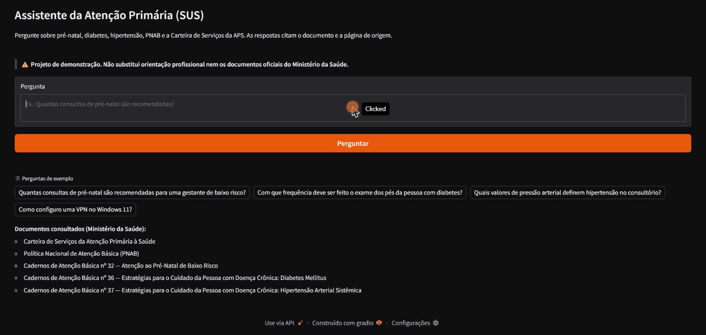
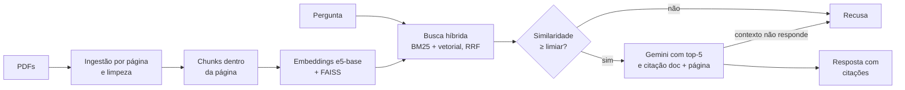

# Assistente RAG da Atenção Primária (SUS)

Assistente de perguntas e respostas sobre documentos oficiais da Atenção Primária à Saúde (APS). Ele usa RAG (busca nos documentos seguida de geração com um LLM), cita documento e página em cada resposta e recusa quando a resposta não está no corpus.

> Projeto de demonstração. Não substitui orientação profissional nem os documentos oficiais.

## Demo

- [link da demo no Hugging Face Spaces]



## Motivação

Na iniciação científica (PIBITI), trabalhando com gestão de Unidades Básicas de Saúde, percebi que profissionais da APS perdem tempo procurando orientações em documentos extensos do Ministério da Saúde. Este projeto testa se um assistente com IA consegue responder essas dúvidas de forma confiável, citando a fonte, e mede isso. É um projeto independente, motivado por essa experiência, e não uma continuação do trabalho da IC.

## Corpus

Cinco documentos públicos do Ministério da Saúde:

| Documento | Arquivo esperado em `data/raw/` |
|---|---|
| Carteira de Serviços da Atenção Primária à Saúde (CaSAPS), versão para profissionais de saúde e gestores | `carteira_servicos_atencao_primaria_saude.pdf` |
| Política Nacional de Atenção Básica (PNAB, Portaria nº 2.488/2011) | `politica_nacional_atencao_basica.pdf` |
| Cadernos de Atenção Básica nº 32: Atenção ao pré-natal de baixo risco | `cadernos_atencao_basica_32_prenatal.pdf` |
| Cadernos de Atenção Básica nº 36: Estratégias para o cuidado da pessoa com doença crônica – Diabetes mellitus | `estrategias_cuidado_pessoa_diabetes_mellitus_cab36.pdf` |
| Cadernos de Atenção Básica nº 37: Estratégias para o cuidado da pessoa com doença crônica – Hipertensão arterial sistêmica | `hipertensao_arterial_sistemica_cab37.pdf` |

Os PDFs não são versionados no repositório. Eles podem ser baixados no portal de publicações do Ministério da Saúde e na Biblioteca Virtual em Saúde (BVS MS). Salve-os em `data/raw/` com os nomes acima: as citações e o conjunto de avaliação usam esses nomes de arquivo.

O índice gerado a partir deles (`data/index/`, 2.395 chunks) **é** versionado, então a demo e a avaliação funcionam sem os PDFs.

## Como funciona



1. **Ingestão** (`src/ingest.py`): extrai o texto página a página com PyMuPDF. Remove as linhas repetidas em mais de 30% das páginas (cabeçalhos e rodapés), junta palavras hifenizadas no fim da linha, normaliza espaços e descarta páginas com menos de 50 caracteres.
2. **Chunking** (`src/chunking.py`): chunks de ~900 caracteres com 150 de sobreposição. Um chunk **nunca atravessa páginas**, e por isso a citação "documento + página" é exata.
3. **Índice** (`src/build_index.py`): embeddings `intfloat/multilingual-e5-base` (prefixos `passage:`/`query:`) normalizados, num FAISS `IndexFlatIP` (similaridade de cosseno).
4. **Busca** (`src/retrieval.py`): modo `vector` (só FAISS) ou `hybrid` (BM25 e vetorial fundidos por Reciprocal Rank Fusion, k=60). Retorna os 5 melhores chunks.
5. **Geração** (`src/generation.py`): o Gemini recebe os 5 chunks identificados por documento e página, responde em português e cita inline no formato `[documento, p. N]`. Citações que não correspondem a um chunk enviado são descartadas.
6. **Recusa em duas camadas**, sempre com o texto fixo "Não encontrei essa informação nos documentos disponíveis.":
   - se a melhor similaridade vetorial da pergunta ficar abaixo do limiar (0,846), o sistema recusa sem chamar o LLM;
   - se o LLM indicar que o contexto não responde, o sistema também recusa.

## Resultados

| Configuração | hit@5 | Citação correta | Recusa correta | Recusas indevidas | Erros de API |
|---|---|---|---|---|---|
| Baseline (vetorial) | 90.0% | 83.3% | 100.0% | 2/30 | 0 |
| Híbrida (BM25 + vetorial, RRF) | 96.7% | 90.0% | 100.0% | 3/30 | 0 |

hit@5 e citação correta sobre 30 perguntas no escopo; recusa correta sobre 5 perguntas fora do escopo. Fonte: [`eval/results/summary.json`](eval/results/summary.json) e [`eval/results/table.md`](eval/results/table.md). Os resultados por pergunta estão em `eval/results/vector.jsonl` e `eval/results/hybrid.jsonl`.

O app usa a busca **híbrida** por padrão (`DEFAULT_MODE = "hybrid"` em `src/config.py`). Ela teve hit@5 maior (29/30 contra 27/30) e mais citações corretas (27/30 contra 25/30), ao custo de uma recusa indevida a mais (3 contra 2).

## Metodologia da avaliação

- **Conjunto:** 35 perguntas em `eval/questions.jsonl`. São 30 no escopo, 6 por documento, e 5 fora do escopo: 3 de saúde não cobertas pelos documentos e 2 sem relação com saúde. Cada pergunta no escopo tem o documento e as páginas onde está a resposta (uma ou mais páginas válidas, base 1).
- **Origem:** o rascunho foi gerado com IA a partir do texto do corpus. Cada página anotada foi conferida contra o texto extraído, e o autor revisou e aprovou o conjunto antes de qualquer medição. A versão para revisão, com um trecho de apoio por página, está em `eval/questions_review.md`.
- **Métricas** (`eval/run_eval.py`):
  - *hit@5:* fração das perguntas no escopo em que algum dos 5 chunks recuperados vem do documento e de uma das páginas anotadas.
  - *Citação correta:* fração das perguntas no escopo em que a resposta cita o documento e uma das páginas anotadas.
  - *Recusa correta:* fração das perguntas fora do escopo em que o sistema responde com o texto fixo de recusa.
  - *Recusas indevidas:* perguntas no escopo que o sistema recusou, por limiar ou pelo LLM.
- **Geração:** modelo `gemini-3.5-flash-lite`, temperatura 0, com pausa entre chamadas e novas tentativas em erros 429/503. As duas execuções finais terminaram com 0 erros de API.
- **Limiar de recusa:** calibrado sem chamar o LLM, com `python -m eval.run_eval --mode vector --retrieval-only`, que varre limiares sobre a melhor similaridade vetorial de cada pergunta. A menor similaridade entre as perguntas no escopo foi 0,856, e a maior entre as de fora do escopo foi 0,864. A regra foi escolher o maior limiar que não recusa nenhuma pergunta no escopo, com margem de ~0,01 abaixo de 0,856. O resultado foi **0,846**. Esse limiar recusa sozinho 1 das 5 perguntas fora do escopo (similaridade 0,795). As outras 4 foram recusadas pelo LLM, nos dois modos.

## Análise de erros

- **q13, critérios para confirmar o diagnóstico de hipertensão (recusada nos dois modos):** a página certa (CAB 37, p. 32) foi recuperada, mas o chunk recuperado começa logo depois da frase com a regra "≥ 140/90 mmHg em pelo menos três dias diferentes". Sem a regra no contexto, o LLM recusou. É um problema de fronteira de chunk, não de busca.
- **q26, cirurgia de unha encravada (cantoplastia) na APS:** é a pergunta no escopo com a menor similaridade (0,856). A resposta está em listas de procedimentos da Carteira de Serviços (p. 16 e 50). No modo vetorial, nenhuma página certa entrou no top-5 e o LLM recusou. No híbrido, o BM25 trouxe a p. 50 pelo termo exato, e a resposta saiu correta.
- **q17 e q21, casos em que o RRF piorou:** na q17 (quando dosar potássio após iniciar diurético tiazídico), o modo vetorial tinha o chunk certo da p. 64 em 1º lugar. A fusão o trocou por outro chunk da mesma página, e o LLM recusou. Na q21 (frequência de visitas do ACS), o vetorial trazia a p. 51 e o híbrido a perdeu, também com recusa. A busca híbrida melhora o hit@5 no agregado, mas não em toda pergunta.
- **Citações "erradas" que apontam páginas válidas (modo vetorial):** na q16 (hipertensão resistente), a resposta cita o CAB 37, p. 74, que também define hipertensão resistente mas não estava anotada. Na q06 (sinais de alarme na gestação que o ACS deve comunicar), a resposta cita a p. 48 em vez da p. 47 anotada. Esses casos contam como erro na métrica, embora a resposta tenha base no documento.

## Limitações

- **Limiar calibrado no mesmo conjunto usado na medição**, com margem pequena (0,846 contra 0,856). A recusa correta e o número de recusas indevidas tendem a ser otimistas para perguntas novas.
- **Conjunto pequeno:** são 35 perguntas, só 5 delas fora do escopo. Cada pergunta no escopo vale 3,3 pontos percentuais, e a recusa correta de 100% se apoia em 5 casos.
- **Anotação incompleta de páginas:** a maioria das perguntas tem uma página anotada, mas a mesma informação às vezes aparece em outras páginas (q16, q06). Por isso a citação correta tende a ser subestimada.
- **Número da página = página do PDF** (base 1), não o número impresso no rodapé do documento, que pode ser diferente.
- **Não substitui orientação profissional** nem a leitura dos documentos oficiais. Os documentos têm data de publicação e podem estar desatualizados em relação a protocolos mais recentes.

## Como rodar

Requer Python 3.10+.

```bash
python -m venv .venv
# Windows: .venv\Scripts\activate    Linux/macOS: source .venv/bin/activate
pip install -r requirements.txt        # ou requirements-dev.txt, que inclui o pytest
```

Crie um `.env` na raiz a partir do `.env.example`:

```
GEMINI_API_KEY=<sua chave>
# GEMINI_MODEL=gemini-3.5-flash-lite   (opcional; este é o padrão)
```

**Reconstruir o índice (opcional, porque o índice já vem versionado em `data/index/`):** coloque os 5 PDFs em `data/raw/` e rode:

```bash
python -m src.ingest        # data/raw/*.pdf -> data/processed/pages.jsonl
python -m src.chunking      # -> data/index/chunks.jsonl
python -m src.build_index   # -> data/index/faiss.index
```

**App (Gradio):**

```bash
python app.py
```

**Avaliação:**

```bash
python -m eval.run_eval --mode vector --retrieval-only   # só busca: hit@5 e varredura de limiares, sem custo de API
python -m eval.run_eval --mode vector                    # baseline completo (chama o Gemini)
python -m eval.run_eval --mode hybrid                    # busca híbrida completa
```

Opções úteis: `--sleep` (pausa entre chamadas, padrão 4 s), `--retries` e `--retry-wait` (novas tentativas em 429/503), `--thresholds 0.80,0.85` (limiares da varredura). Os resultados vão para `eval/results/`.

**Testes:**

```bash
pytest
```

## Estrutura do repositório

```
app.py                  # entrada do Hugging Face Spaces (chama src/app.py)
src/
  config.py             # constantes: caminhos, chunking, modelo, limiar, modo padrão
  schema.py             # tipos Hit e Answer
  ingest.py             # PDFs -> páginas limpas
  chunking.py           # páginas -> chunks (sem atravessar páginas)
  build_index.py        # embeddings + FAISS
  retrieval.py          # busca vetorial e híbrida (BM25 + RRF)
  generation.py         # prompt, Gemini, citações e recusa
  app.py                # interface Gradio
data/
  raw/                  # PDFs (não versionados)
  processed/            # pages.jsonl (não versionado)
  index/                # chunks.jsonl + faiss.index (versionados)
eval/
  questions.jsonl       # conjunto de avaliação aprovado
  questions_review.md   # versão legível com trechos de apoio
  run_eval.py           # métricas e varredura de limiares
  results/              # resultados por pergunta, summary.json, table.md
tests/                  # pytest
docs/                   # PRD, plano e guia de deploy
```

**Stack:** Python, PyMuPDF, sentence-transformers (`intfloat/multilingual-e5-base`), FAISS, rank-bm25, Google Gemini (`google-genai`), Gradio e Hugging Face Spaces.

O passo a passo de publicação no Spaces está em [`docs/deploy-spaces.md`](docs/deploy-spaces.md).

## Summary (English)

RAG question-answering assistant over five official Brazilian Ministry of Health documents on Primary Health Care (SUS). It answers in Portuguese, cites document and page for each claim, and refuses when the answer is not in the corpus, using a similarity threshold plus an LLM check. Pipeline: page-level PDF extraction, page-bounded chunks, multilingual-e5-base embeddings with FAISS, and hybrid BM25 + vector search fused with RRF, followed by generation with Gemini (`gemini-3.5-flash-lite`, temperature 0).
On a 35-question evaluation set (30 in scope, 5 out of scope), hybrid search reached 96.7% hit@5 and 90.0% correct citations, against 90.0% and 83.3% for the vector baseline. Both modes refused all 5 out-of-scope questions, with 3 and 2 wrong refusals respectively. The threshold was tuned on the same set, so these numbers are likely optimistic.
Demo: [link da demo no Hugging Face Spaces]
